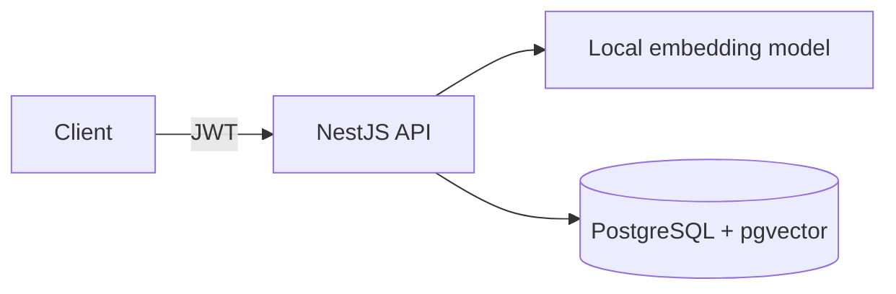

# nest-rag-service

NestJS Retrieval-Augmented Generation (RAG) service with Prisma, PostgreSQL + pgvector,
local embeddings, and JWT authentication.


## Overview

Ingest text documents, embed them with a local model, and answer questions using the most similar documents as context. See docs/architecture.md for flows and known limitations.
(cost, privacy, latency)?

## Architecture



Details: [docs/architecture.md](docs/architecture.md)

## Tech stack

- NestJS (TypeScript)
- Prisma
- PostgreSQL with pgvector
- Local embedding model: deepvk/USER-bge-m3 (1024 dimensions), OpenAI-compatible server
- Chat: any OpenAI-compatible provider (Groq by default)
- JWT authentication
- Vitest, oxlint, Prettier, Docker Compose

## Quick start

```bash
cp .env.example .env        # then fill in values, see docs/configuration.md
docker compose up -d        # start PostgreSQL + pgvector
yarn install
# TODO: add the exact Prisma generate/migrate commands used in this repo
yarn start:dev
```

## API overview

| Method | Endpoint | Description |
| ------ | -------- | ----------- |
| TODO   | TODO     | Register / login |
| TODO   | TODO     | Upload / ingest document |
| TODO   | TODO     | Query |

Interactive docs (Swagger): `http://localhost:3000/api/docs` (after Swagger setup).

## Documentation

- [Architecture](docs/architecture.md)
- [Configuration](docs/configuration.md)
- [Database](docs/database.md)
- [Testing](docs/testing.md)
- [Operations](docs/operations.md)
- [Architecture decisions](docs/adr/)

## Testing

```bash
yarn test        # unit
yarn test:e2e    # end-to-end
```

## Contributing

See [CONTRIBUTING.md](CONTRIBUTING.md).

## License

[MIT](LICENSE)
