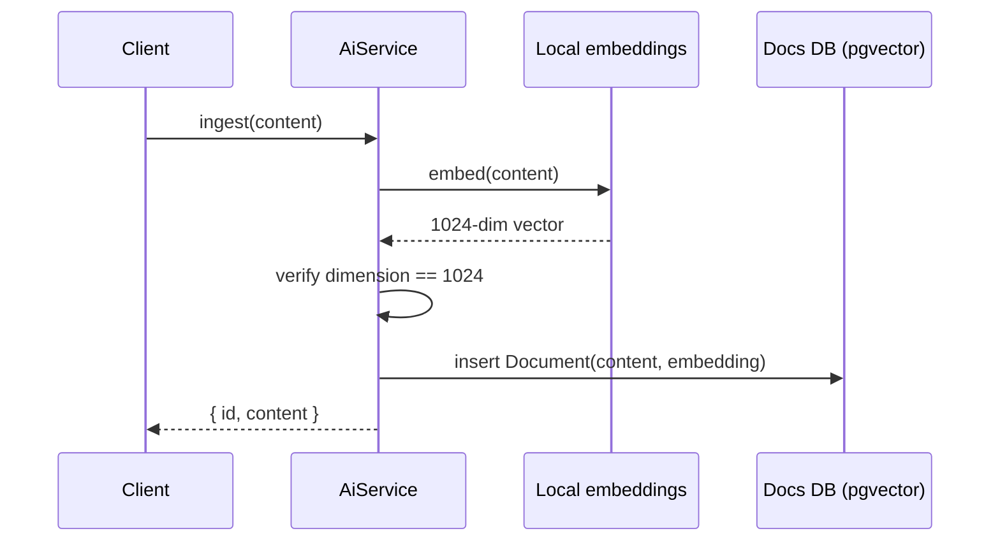
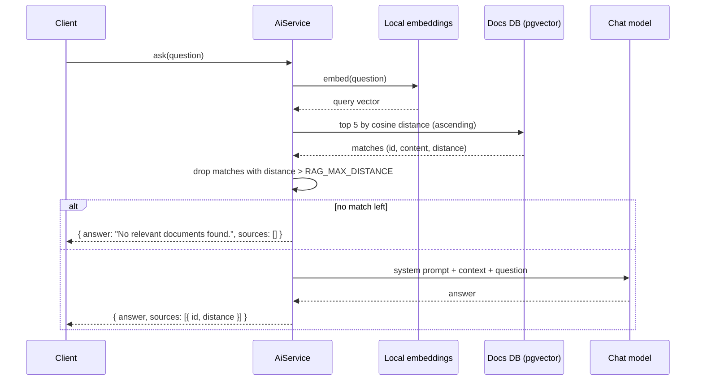
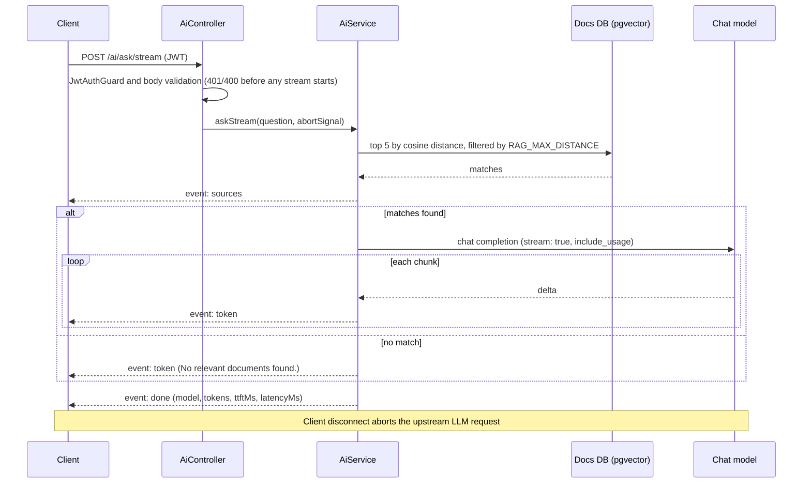

# Architecture

## Components
- **NestJS API**: HTTP layer, JWT auth, request validation (DTOs)
- **UserService**: register, login (bcrypt + JWT), user CRUD (users DB)
- **AiService**: embedding, ingestion, retrieval, answer generation, and streamed answers (docs DB)
- **Embedding server (local)**: OpenAI-compatible, model `deepvk/USER-bge-m3`, 1024 dimensions
- **Chat provider**: OpenAI-compatible (Groq by default), model `openai/gpt-oss-120b` (set via `CHAT_MODEL`)
- **PostgreSQL**: users DB, and docs DB with pgvector

## HTTP endpoints
| Method | Path | Auth | Description |
| ------ | ---- | ---- | ----------- |
| POST | `/ai/documents` | JWT | Ingest a document (embed and store) |
| POST | `/ai/ask` | JWT | Ask a question, full answer in one JSON response |
| POST | `/ai/ask/stream` | JWT | Ask a question, answer streamed over SSE |

Request bodies are validated: `question` (max 1000 characters) and `content` (max 20000 characters) must be non-empty strings after trimming. Invalid input returns `400` with a list of messages, also for the stream endpoint (it happens before the stream starts).

TODO: list the auth and user endpoints (register, login, user CRUD) and which ones require JWT.

## Ingestion flow

## Query flow

The system prompt tells the model to answer only from the provided context and to say it does not know otherwise. See [ADR-0006](0006-similarity-threshold.md) for the distance filter.

## Streaming query flow (SSE)
`POST /ai/ask/stream` runs the same retrieval, then streams the answer as Server-Sent Events. See [ADR-0005](0005-sse-streaming.md).

### SSE events
| Event | Data |
| ----- | ---- |
| `sources` | `[{ id, distance }]`, sent before the first token (empty if nothing matched) |
| `token` | JSON string with the next piece of the answer |
| `done` | `{ model, promptTokens, completionTokens, ttftMs, latencyMs }`. The token fields are missing when no chat call was made |
| `error` | `{ message }`, sent if the stream fails after it has started |

Errors raised before the stream starts (missing or invalid JWT, validation) are normal HTTP error responses, not SSE events.

## Retrieval parameters
| Parameter | Value |
| --------- | ----- |
| Chunking | none, each document is one vector |
| Embedding model / dimensions | deepvk/USER-bge-m3 / 1024 |
| Similarity metric | cosine distance (`<=>`) |
| top-k | 5 |
| Similarity threshold | cosine distance <= 0.45 (`RAG_MAX_DISTANCE`) |

## Measured behavior
From the baseline run (10 questions, small document set, see [benchmarks](benchmarks.md)):
- P50 latency 813 ms, P95 1285 ms, average cost about 0.000073 USD per query.
- On-topic questions had a top distance of 0.23 to 0.41. All 4 off-topic questions were filtered out and did not call the chat model.
- `openai/gpt-oss-120b` is a reasoning model, so `completionTokens` is larger than the visible answer (hidden reasoning is counted in output cost).
- Time to first token is close to total latency, because it includes embedding, the DB search and the model's reasoning time before the first token.

## Known limitations
- No chunking, so long documents may exceed the embedding model's input limit.
- The distance threshold was chosen from a small test set. The highest on-topic distance seen (0.411) is close to the limit (0.45), so a rephrased question may be filtered by mistake. It has to be re-tuned when the embedding model or the documents change.
- The distance filter runs in application code after the top-5 query, not in SQL.
- No vector index is confirmed yet, so similarity search may be a sequential scan (see [database](database.md)).
- Documents have no owner, so all authenticated users share one document pool.
- Swagger UI shows a streamed response only after it finishes. Use `curl -N` to see tokens arrive.
