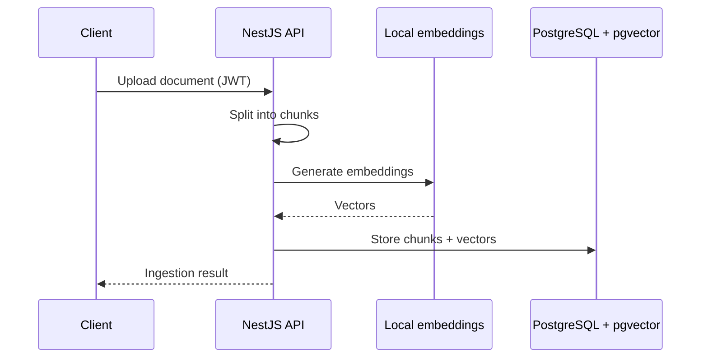
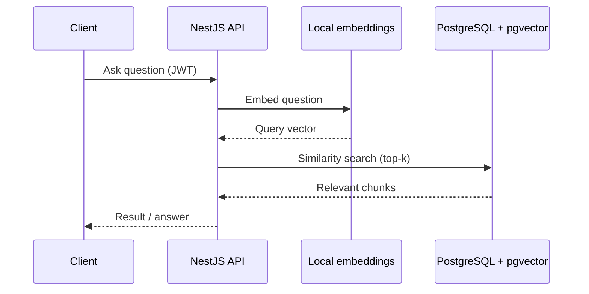

# Architecture

## Components
- **NestJS API**: HTTP layer, JWT auth, validation
- **Embedding model (local)**: TODO name, dimensions
- **PostgreSQL + pgvector**: stores documents, chunks, and vectors

## Ingestion flow

## Query flow

## Retrieval parameters
| Parameter | Value |
| --------- | ----- |
| Chunk size / overlap | TODO |
| Embedding model / dimensions | TODO |
| Similarity metric | TODO (cosine / L2 / inner product) |
| Vector index | TODO (HNSW / IVFFlat) |
| top-k | TODO |
