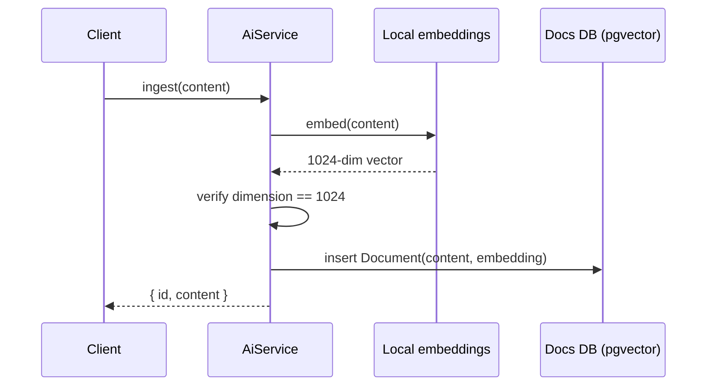
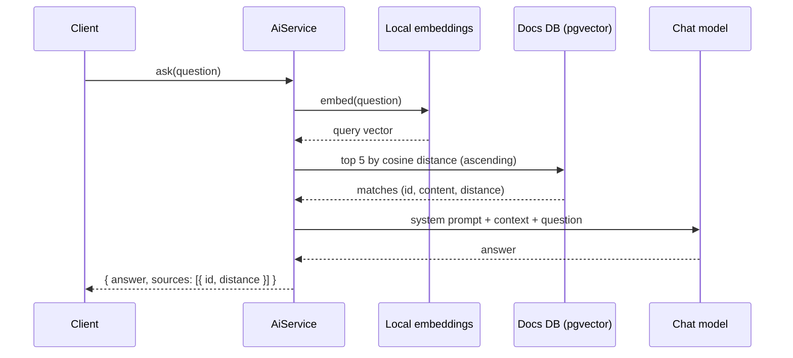

# Architecture

## Components
- **NestJS API**: HTTP layer, JWT auth, validation
- **UserService**: register, login (bcrypt + JWT), user CRUD (users DB)
- **AiService**: embedding, ingestion, retrieval and answer generation (docs DB)
- **Embedding server (local)**: OpenAI-compatible, model `deepvk/USER-bge-m3`, 1024 dimensions
- **Chat provider**: OpenAI-compatible (Groq by default), model `openai/gpt-oss-120b`
- **PostgreSQL**: users DB, and docs DB with pgvector

## Ingestion flow

## Query flow

The system prompt tells the model to answer only from the provided context and to say it does not know otherwise.

## Retrieval parameters
| Parameter | Value |
| --------- | ----- |
| Chunking | none, each document is one vector |
| Embedding model / dimensions | deepvk/USER-bge-m3 / 1024 |
| Similarity metric | cosine distance (`<=>`) |
| top-k | 5 |
| Similarity threshold | none |

## Known limitations
- No chunking, so long documents may exceed the embedding model's input limit.
- No similarity threshold, so unrelated questions still return the 5 nearest documents.
- Documents have no owner, so all authenticated users share one document pool.
- TODO: list HTTP endpoints and which ones require JWT.
