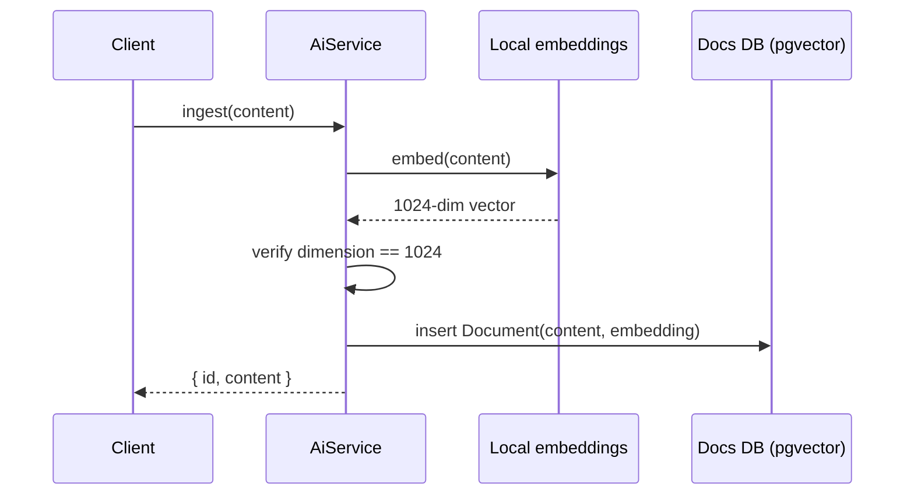
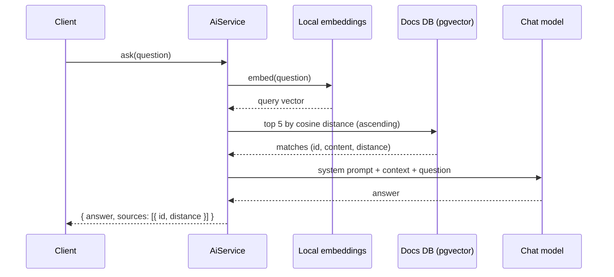
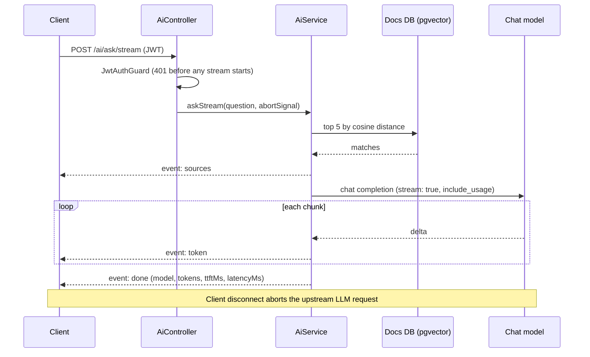

# Architecture

## Components
- **NestJS API**: HTTP layer, JWT auth, validation
- **UserService**: register, login (bcrypt + JWT), user CRUD (users DB)
- **AiService**: embedding, ingestion, retrieval, answer generation, and streamed answers (docs DB)
- **Embedding server (local)**: OpenAI-compatible, model `deepvk/USER-bge-m3`, 1024 dimensions
- **Chat provider**: OpenAI-compatible (Groq by default), model `openai/gpt-oss-120b` (set via `CHAT_MODEL`)
- **PostgreSQL**: users DB, and docs DB with pgvector

## HTTP endpoints
| Method | Path | Auth | Description |
| ------ | ---- | ---- | ----------- |
| POST | `/ai/documents` | JWT | Ingest a document (embed and store) |
| POST | `/ai/ask` | JWT | Ask a question, full answer in one JSON response |
| POST | `/ai/ask/stream` | JWT | Ask a question, answer streamed over SSE |

TODO: list the auth and user endpoints (register, login, user CRUD) and which ones require JWT.

## Ingestion flow

## Query flow

The system prompt tells the model to answer only from the provided context and to say it does not know otherwise.

## Streaming query flow (SSE)
`POST /ai/ask/stream` runs the same retrieval, then streams the answer as Server-Sent Events. See [ADR-0005](adr/0005-sse-streaming.md).

### SSE events
| Event | Data |
| ----- | ---- |
| `sources` | `[{ id, distance }]`, sent before the first token |
| `token` | JSON string with the next piece of the answer |
| `done` | `{ model, promptTokens, completionTokens, ttftMs, latencyMs }` |
| `error` | `{ message }`, sent if the stream fails after it has started |

Errors raised before the stream starts (missing or invalid JWT, validation) are normal HTTP error responses, not SSE events.

## Retrieval parameters
| Parameter | Value |
| --------- | ----- |
| Chunking | none, each document is one vector |
| Embedding model / dimensions | deepvk/USER-bge-m3 / 1024 |
| Similarity metric | cosine distance (`<=>`) |
| top-k | 5 |
| Similarity threshold | none (planned, see below) |

## Observations from first manual tests
Small data set (4 documents), so treat these as a starting point, not a tuned value.
- Relevant documents had a cosine distance of about 0.25 to 0.34. Unrelated documents were 0.51 or higher, so a threshold around 0.45 looks workable. To be tuned on the baseline questions.
- `openai/gpt-oss-120b` is a reasoning model. In one test the answer was about 20 tokens but `completionTokens` was 81, so hidden reasoning tokens are counted in output cost.
- Time to first token is close to total latency, because it includes embedding, the DB search and the model's reasoning time before the first token.

## Known limitations
- No chunking, so long documents may exceed the embedding model's input limit.
- No similarity threshold, so unrelated questions still return the 5 nearest documents, and those are sent to the model as context (extra token cost). Planned: filter by a maximum distance, and skip the LLM call when nothing passes.
- No input validation on `question` and `content` (empty strings are accepted). Planned: DTOs with class-validator.
- Documents have no owner, so all authenticated users share one document pool.
- Swagger UI shows a streamed response only after it finishes. Use `curl -N` to see tokens arrive.
