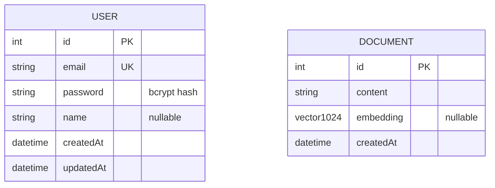

# Database

The service uses two PostgreSQL databases, each with its own Prisma config and migrations.

| Database | Env var | Prisma config | Contract | Migrations |
| -------- | ------- | ------------- | -------- | ---------- |
| Users | USERS_DATABASE_URL | prisma.users.config.ts | prisma/users/contract.prisma | prisma/users/migrations |
| Docs | DOCS_DATABASE_URL | prisma.docs.config.ts | prisma/docs/contract.prisma | prisma/docs/migrations |

The docs database loads the pgvector extension (`@prisma/orm-extension-pgvector`).

## Models

The two models live in different databases and are not linked by a foreign key.

## Migrations
TODO: add the exact commands (check the scripts in package.json).

## Vector index
TODO: confirm whether an HNSW/IVFFlat index exists in the docs migrations. If not, similarity search is a sequential scan.
