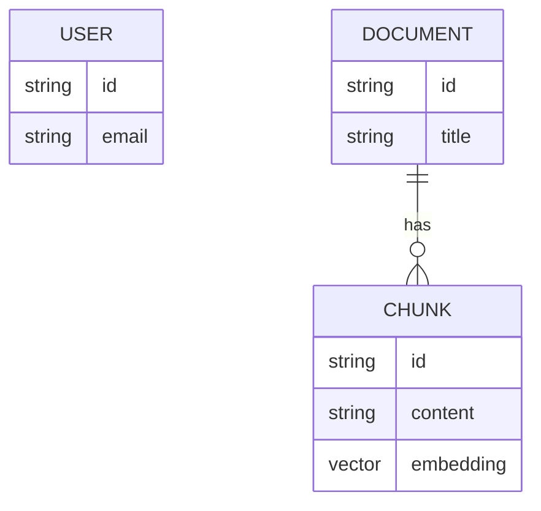

# Database

- PostgreSQL with the `pgvector` extension
- Prisma schemas/configs: `prisma.docs.config.ts`, `prisma.users.config.ts`

## ER diagram

TODO: replace with the real models.

## Migrations
TODO: exact commands for each Prisma config.

## Vector index
TODO: index type, parameters, and why.
